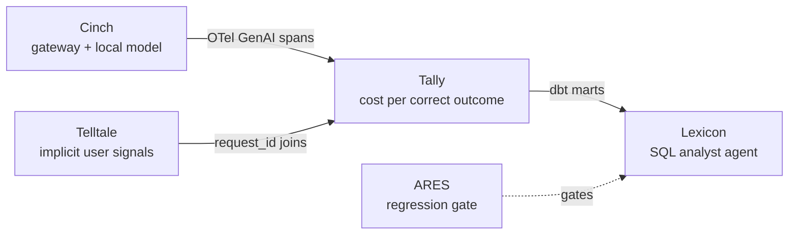

# Tally: Objective and What To Do

> Most teams track cost per token. Tally tracks **cost per correct result** and uses that number to decide which model handles each request.

Cinch serves the model. Tally keeps score: what each request cost, and whether it worked.

---

## 1. The question Tally answers

"For a real, checkable workload, which serving setup gives the lowest **cost per correct outcome**, and how much accuracy do I give up to get it?"

Token cost alone misleads. A model that costs half as much per token but gets 20% more tickets wrong can cost more per *correct* ticket once you count the human time spent fixing the misroutes. Tally measures that end to end, on held-out data, with every number traceable to a row in Postgres.

## 2. The experiment in one paragraph

Support-ticket triage on the Bitext customer-support dataset (labeled intent + category). Split 60/20/20 (develop / tune / test, stratified by intent, fixed seed). Run four setups on the **same** tickets:

| Setup | What it is | Why it is in the study |
|---|---|---|
| **A. No LLM** | TF-IDF + logistic regression | The baseline everyone skips. If it wins, say so. |
| **B. Local** | Qwen2.5-7B-Instruct AWQ INT4, served through Cinch | Your own GPU, your own gateway |
| **C. Hosted** | One cheap API model | The default most teams reach for |
| **D. Cascade** | B first; escalate to C when B's label confidence < τ or B's output fails validation | The thing you are actually selling |

τ is chosen on the tune split only. Every headline number comes from the test split.

## 3. Deliverables (definition of done)

1. `make reproduce` rebuilds everything from a clean clone: data download and split, all four setups, OTel ingest, `dbt build`, figures, and the report. A replay mode reproduces it with no GPU and no API key, using the recorded responses.
2. Postgres warehouse with dbt models: `fct_requests`, `fct_outcomes`, `dim_tenant`, `dim_prompt_version`, `mart_cost_per_outcome` (plus staging layers and dbt tests). Lexicon queries these tables later, so treat them as a public contract.
3. A Streamlit dashboard with:
   - The **hero chart**: cost per 1,000 tickets (log x) vs accuracy (y), one point per setup with 95% CIs, plus the τ-sweep frontier for the cascade.
   - Cost per correct triage by tenant, model and prompt version.
   - Cache savings, and escalation rate over time.
4. A case-study page (`docs/CASE_STUDY.md` rendered into the dashboard and README) with the hero chart and the README headline:
   **"Router achieved X% of the hosted model's accuracy at Y% of its cost per correct triage."** Real numbers, test split, CIs. A modest true result beats an impressive false one.
5. A documented cost model (`config/cost_model.yaml`) and an ROI sensitivity table, because the ROI depends entirely on those assumptions.

## 4. Success criteria

| Criterion | Bar |
|---|---|
| Reproducibility | Clean clone → `make reproduce` → identical test-split numbers in replay mode |
| Statistical honesty | Every accuracy and cost-per-correct number has a bootstrap 95% CI; pairwise setup differences tested with McNemar |
| Leakage | τ, prompts and few-shot examples never touch the test split (enforced by a test) |
| Traceability | Every chart number traces to a dbt model; every dbt model has tests |
| Quality bar | ≥ 85% line coverage on `src/`, ruff + mypy clean, CI green |
| Honesty | The README states the baseline result, the cost assumptions, and the known limitations (synthetic dataset, possible contamination) |

## 5. Non-goals

- Building a new gateway. Cinch is the gateway; Tally only asks Cinch for a small set of changes, spelled out in `docs/CINCH_CHANGES.md`.
- A general LLM observability product (Langfuse, Helicone and Phoenix exist). Tally is one rigorous study plus a reusable cost-per-outcome warehouse.
- Fine-tuning. Setup A covers trained models; B and C are prompted.

## 6. Where Tally sits

Tally is the hub. Its warehouse is the data Lexicon reasons over, and the cost ledger Telltale joins user behaviour to.

## 7. Timeline

About 5 weeks (portfolio weeks 1 to 5). Week-by-week plan with daily checkpoints: [`docs/ROADMAP.md`](docs/ROADMAP.md).

## 8. Doc map

| File | Read it when |
|---|---|
| `AGENTS.md` | Before any coding session (rules for every AI coding agent) |
| `CLAUDE.md` / `GEMINI.md` | Tool-specific entry points; both import `AGENTS.md` |
| `docs/BUILD_SPEC.md` | The full technical spec: architecture, schemas, methods, acceptance tests |
| `docs/ROADMAP.md` | Planning the week |
| `docs/CINCH_CHANGES.md` | The PR you make in the Cinch repo (Tally never edits Cinch) |
| `docs/CONTRACTS.md` | Cross-project contract: `request_id`, tenant ids, table names. Lexicon and Telltale depend on it |
| `docs/DECISIONS.md` | Architecture decision records, with the reasoning |
| `docs/RESEARCH.md` | Sources, prior work, verified facts and prices |
| `docs/CASE_STUDY_TEMPLATE.md` | Skeleton for the Week 5 case study (becomes `docs/CASE_STUDY.md`) |
| `docs/PORTFOLIO_PLAN.md` | The 12-week plan across Tally, Lexicon and Telltale, and how they land on your portfolio site |
