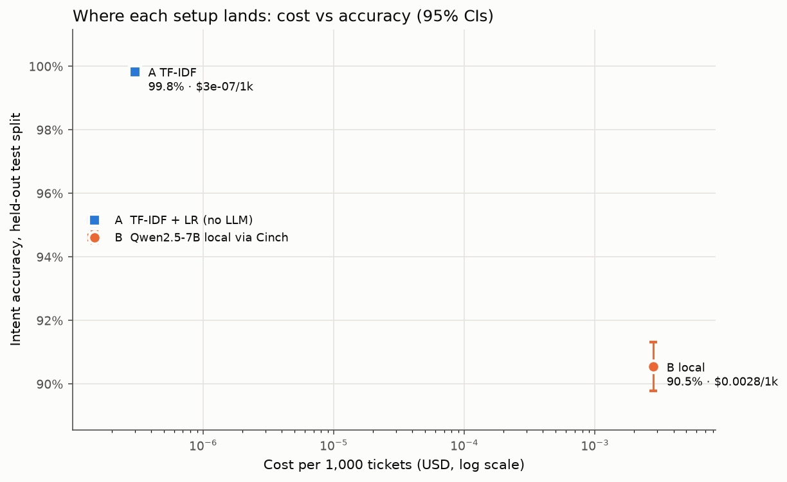
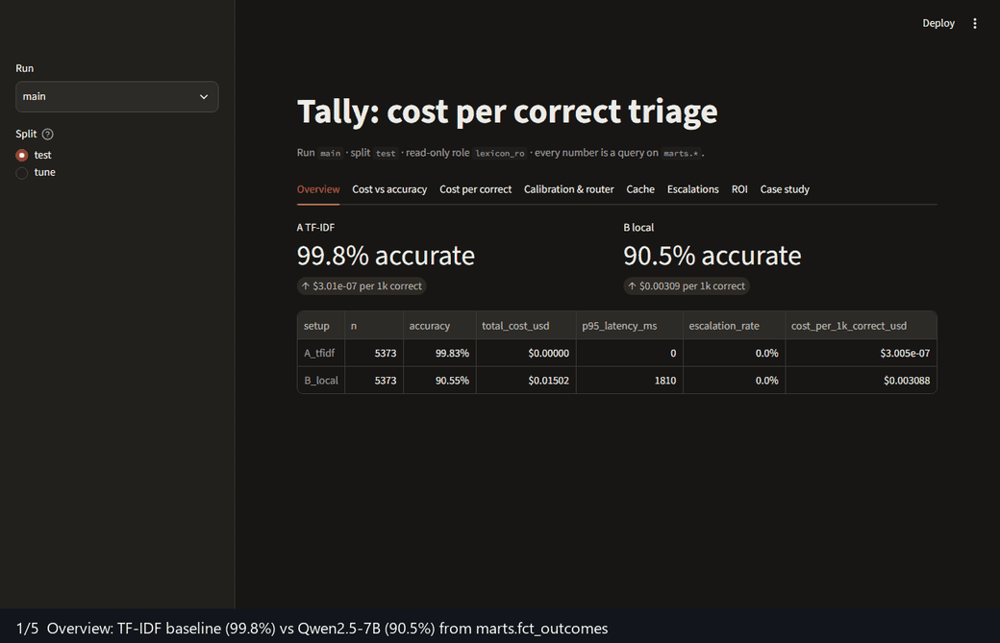
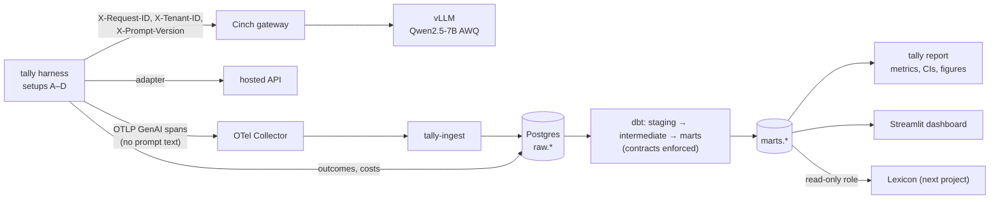

# Tally

**Cost per correct outcome for LLM traffic.** Most teams track cost per token. Tally tracks what each *correct* answer costs, on held-out data, and uses that number to decide which model handles a request.

Cinch serves the model. Tally keeps score.

<!-- tally:results:start -->
> Hosted setup C and the cascade D have not run yet. On the held-out test split, the local model reached **90.5%** accuracy at **$0.00309 per 1,000 correct triages**, while the no-LLM baseline reached **99.8%** at **$3e-07 per 1,000**.
>
> Test split, n = 5,373 tickets per setup, run `main`. Every number below is generated by `tally report` from the warehouse.

| Setup | Accuracy (95% CI) | Macro-F1 | Cost per 1k tickets | Cost per 1k correct | p95 latency | Escalated |
|---|---|---|---|---|---|---|
| A  TF-IDF + LR (no LLM) | 99.8% (99.7%–99.9%) | 0.998 | $3e-07 ($3e-07–$3e-07) | $3.01e-07 ($3e-07–$3.01e-07) | 0.05 ms | – |
| B  Qwen2.5-7B local via Cinch | 90.5% (89.8%–91.3%) | 0.902 | $0.0028 ($0.0028–$0.0028) | $0.00309 ($0.00306–$0.00311) | 1,810 ms | – |
| C  hosted API model | not run | | | | | |
| D  cascade B→C | not run | | | | | |

**Key findings** (generated):

- The no-LLM baseline beat the 7B model on accuracy (99.8% vs 90.5%) and was 10,276x cheaper per correct triage.
- Labels decide it: with 10 labelled examples per intent the baseline scores 89.6%, below the prompted model's 90.5%; with 25 per intent it scores 96.1%.
- Cinch's semantic cache, as shipped, answered 99.6% of tickets from cache and only 3.3% of those hits carried the right label: accuracy fell from 90.5% to 3.7% (fix specified in docs/CINCH_CHANGES.md, C3).
- Two labelled examples per intent in the prompt lifted the local model from 84.7% to 91.0% on tune (`ticket_triage.fewshot_static.v3` chosen).
- Hosted setup C and the cascade D are implemented and tested but not yet run (ADR-015); `tally run --mode auto --confirm-spend` completes them.
<!-- tally:results:end -->



## Dashboard demo



## Status

| Part | State |
|---|---|
| Setups A and B on the full tune and test splits (16,123 local-model calls recorded on an RTX 3060 Ti) | Done |
| Cache experiment (B with Cinch's semantic cache on, 5,373 calls) | Done |
| Warehouse, dbt marts (46/46 models and tests), report, dashboard | Done |
| `tally reproduce` from recordings alone | Verified: identical `metrics.json` and decisions (2m 23s) |
| Setup C (hosted Gemini) and the cascade D | Built and tested end to end against mocked endpoints, **not run**. The Gemini free tier allows 20 requests a day; enabling billing (about $1.70) completes them. See ADR-015. |

## What the study does

Support-ticket triage on the [Bitext customer-support dataset](https://huggingface.co/datasets/bitext/Bitext-customer-support-llm-chatbot-training-dataset): 26,872 tickets, 27 intents, 11 categories. "Correct" is checkable, because every ticket has a gold intent.

Four setups see the **same** tickets:

| Setup | What it is |
|---|---|
| **A** | TF-IDF (word 1-2 grams + char 3-5 grams) + logistic regression. The baseline most teams skip. |
| **B** | Qwen2.5-7B-Instruct AWQ (INT4) on an RTX 3060 Ti, served by vLLM behind the [Cinch](../Cinch) gateway, with guided choice over the 27 labels and token logprobs. |
| **C** | One cheap hosted API model (`gemini-2.5-flash-lite`) with a JSON-schema enum. **Not run yet** (see Status). |
| **D** | Cascade: B answers first; escalate to C when B's *calibrated* confidence is below τ, or B's output is invalid. **Not run yet.** |

Rules that keep the numbers honest:

- **Sealed test split.** 60/20/20 dev/tune/test, stratified by intent and split by **near-duplicate cluster** (MinHash, Jaccard ≥ 0.8), so paraphrases of a test ticket never sit in dev. The split hashes are committed in [`data/splits/manifest.json`](data/splits/manifest.json), and a test fails if they change.
- **Every choice is made on tune**: the prompt version, TF-IDF's C, the calibration temperature and τ. The τ objective was fixed before any test run (ADR-010). A dbt test and a pytest test both fail if a selection run touches test.
- **Uncertainty everywhere**: a paired bootstrap over tickets (2,000 resamples) for every accuracy and cost-per-correct number, and exact McNemar tests with Holm correction between setups.
- **Cost per correct is a ratio of sums**: Σ cost ÷ # correct over the same tickets. A cascade pays for both calls when it escalates.

## How the data flows



- **Telemetry** follows the OpenTelemetry GenAI semantic conventions: `gen_ai.provider.name`, `gen_ai.usage.input_tokens` and so on, plus `tally.*` attributes. Cinch does not export spans yet, so the harness emits them client-side. [`docs/CINCH_CHANGES.md`](docs/CINCH_CHANGES.md) specs the Cinch PR that moves this into the gateway.
- **Warehouse**: Postgres 16 with five public marts: `fct_requests`, `fct_outcomes`, `dim_tenant`, `dim_prompt_version` and `mart_cost_per_outcome`. dbt model contracts enforce them ([`docs/CONTRACTS.md`](docs/CONTRACTS.md)). Lexicon reads them through a read-only role.
- **Tenants**: three simulated teams (`support`, `billing`, `sales`) that send different category mixes.

## The cost model

Every input is in [`config/cost_model.yaml`](config/cost_model.yaml), and the report shows how the answer moves when they change.

- **Local GPU**: (card price ÷ lifetime + measured power × tariff) ÷ (measured requests per hour × utilisation). `nvidia-smi` samples power every 0.5 s during the run, and the throughput is the real wall-clock rate at the run's concurrency. Utilisation below 1 charges idle hours to the paid work. A second method prices the GPU at an equivalent cloud GPU-hour.
- **Hosted**: tokens × list price, with the date the price was checked. An unpriced model raises an error instead of costing $0.
- **Cache hit**: near zero.
- **ROI** = correct × minutes saved × wage − wrong × misroute minutes × wage − AI cost. The misroute term matters: without it, a cheap and inaccurate setup looks profitable. The sensitivity grid covers 27 combinations.

## Reproduce it

One command rebuilds everything from recorded responses. It needs no GPU, no API key and no spend:

```bash
uv sync --all-extras
docker compose up -d --build postgres tally-ingest otel-collector
uv run tally reproduce          # data -> run (replay) -> publish -> dbt build -> report
uv run tally dashboard          # http://localhost:8501
```

To record new responses you need an NVIDIA GPU and, for C, an API key:

```bash
docker compose --profile model up -d                      # vLLM + Cinch (weights read from $TALLY_DOWNLOAD_DIR)
uv run tally run --mode auto                              # B live, C only with --confirm-spend
uv run tally run --mode auto --confirm-spend              # prints the estimated hosted spend first
CINCH_SEMANTIC_CACHE=true docker compose --profile model up -d cinch
uv run tally run --mode auto --cache-arm                  # B again with Cinch's semantic cache on
```

| Command | What it does |
|---|---|
| `tally data` | Downloads Bitext at a pinned revision, clusters near-duplicates, rebuilds the split and verifies it against the manifest |
| `tally run` | Runs the setups and writes `reports/runs/<run_id>/` |
| `tally publish` | Loads outcomes and costs into `raw.*`, exports spans over OTLP, and waits until they land |
| `tally dbt build` | Builds the models with contracts, plus the dbt data tests |
| `tally report` | Writes `metrics.json`, the figures, [`docs/RESULTS.md`](docs/RESULTS.md), [`docs/CASE_STUDY.md`](docs/CASE_STUDY.md) and the block at the top of this README |

## Quality bar

- `pytest`: unit, property (Hypothesis), contract and end-to-end tests. The end-to-end test runs the full harness against mocked endpoints, then checks that a **replay** reproduces identical decisions and costs. Coverage is above 85%.
- `ruff`, `ruff format` and `mypy --strict` are clean.
- dbt runs contract, uniqueness and relationship tests plus seven custom checks:
  - cost per correct equals a recompute
  - every call is costed
  - every outcome has its spans
  - hosted cost equals tokens × price
  - no selection run on test
  - cascade cost is the sum of its parts
  - 100% of harness decisions reach the warehouse

## Limitations

- Bitext is template-generated. Even with the cluster split, it is easier than real tickets, and a public dataset may sit in a model's training data.
- One GPU, one local model, one hosted model, list prices as of 2026-11-19.
- The labour inputs to ROI are assumptions; the sensitivity table shows how much they move the answer.
- Cinch was run unmodified with environment overrides (no rate limit, no prompt compaction, no cascade router). Its semantic cache was off for headline numbers, because it compares whole prompts lexically (see the cache section of the case study).

## Docs

[Objective](OBJECTIVE.md) · [Build spec](docs/BUILD_SPEC.md) · [Results (generated)](docs/RESULTS.md) · [Case study](docs/CASE_STUDY.md) · [Contracts](docs/CONTRACTS.md) · [Decisions](docs/DECISIONS.md) · [Cinch changes](docs/CINCH_CHANGES.md) · [Research notes](docs/RESEARCH.md) · [Roadmap](docs/ROADMAP.md)

Part of a series: **Cinch** (serving) → **Tally** (cost per correct) → **Lexicon** (SQL agent over Tally's marts, gated by ARES) → **Telltale** (what users do with AI output). See [`docs/PORTFOLIO_PLAN.md`](docs/PORTFOLIO_PLAN.md).

License: Apache-2.0. The dataset is not redistributed; it is downloaded under CDLA-Sharing-1.0.
