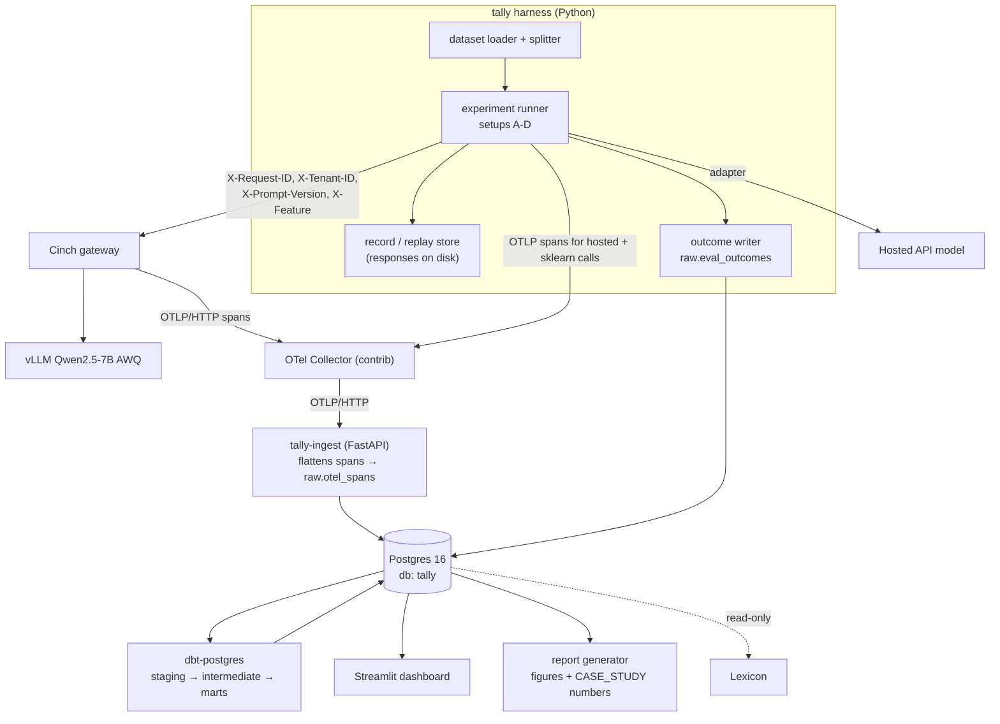

# Tally Build Spec

Status: v1, 2026-11-19. This is the full technical spec. The objective and done-criteria are in `../OBJECTIVE.md`. Facts marked [R§n] are sourced in `RESEARCH.md` §n.

---

## 0. Summary of design choices that differ from the original pitch, and why

| Pitch said | Spec does | Reason |
|---|---|---|
| Tenants support / sales / internal-docs | support / billing / sales, plus an optional `finance-ops` tenant on a second dataset | "Correct" must be machine-checkable. Internal-docs Q&A has no gold label in Bitext. A Banking77 tenant adds a harder, real-language workload instead. |
| Escalate on logprob < τ | Escalate on **calibrated** label probability < τ, or a validation failure | Raw logprobs from instruction-tuned models are overconfident. Calibrating on the tune split (temperature scaling) makes τ mean something, and the reliability diagram becomes a figure in its own right. |
| ROI = correct × minutes saved × wage − AI cost | ROI also subtracts **wrong triages × misroute penalty** | A misrouted ticket costs re-handling time. Without that term the cheapest wrong model looks profitable. |
| One workload | Bitext as primary; Banking77 as robustness check (stretch); a **label-budget learning curve** for setup A | Bitext is template-generated, so TF-IDF may score very high on it. The interesting story then becomes *when* an LLM beats a trained classifier: few labels, or a taxonomy that changes. Design for that outcome from day one. |
| Cinch emits spans | Cinch needs a PR first (`CINCH_CHANGES.md`); client-side spans are the fallback | Reading Cinch showed spans are never exported, and cache hits lack a request id. |

---

## 1. Architecture



### 1.1 Why a small ingest service between the collector and Postgres
The OTel Collector contrib distribution has no maintained PostgreSQL exporter [R§3]. There are three ways to bridge that gap:

| Option | Pros | Cons |
|---|---|---|
| **(a) Collector → `otlphttp` → tally-ingest → Postgres** (recommended) | Standard OTLP everywhere. The ingest service is ~150 lines and fully testable. You control the flattening of `gen_ai.*` attributes into columns. | One more service |
| (b) Collector `file` exporter → batch loader | Simplest | Not real-time; file rotation edge cases |
| (c) Collector → ClickHouse exporter | Native exporter | Second database; Lexicon and dbt would then target ClickHouse |

Option (a) keeps the collector, which you can talk about in interviews: batching, retries, a `transform`/`attributes` processor that drops any content attributes as defence in depth. It also keeps Postgres as the single warehouse.

### 1.2 Services (`docker-compose.yml`)
| Service | Image | Port |
|---|---|---|
| postgres | `postgres:16` | 5432 |
| otel-collector | `otel/opentelemetry-collector-contrib` (pinned tag) | 4317 (gRPC), 4318 (HTTP) |
| tally-ingest | built from `src/tally/ingest` | 8090 |
| dashboard | built from `dashboard/` | 8501 |

Cinch runs from its own repo with `OTEL_EXPORTER_OTLP_ENDPOINT=http://host.docker.internal:4318`.

---

## 2. Repository layout

```
Tally/
  config/
    experiment.yaml       # splits, seeds, setups, τ grid, bootstrap n
    tenants.yaml          # tenant → category mix, budget, prompt_version
    cost_model.yaml       # GPU, electricity, utilisation, API prices, cache cost
    roi.yaml              # minutes saved, wage, misroute penalty, sensitivity grid
    prompts/              # ticket_triage.zero_shot.v1.jinja, ...fewshot.v2.jinja, ...
  data/splits/manifest.json   # committed: row ids per split + sha256
  src/tally/
    data/       # bitext.py, banking77.py, split.py
    setups/     # a_tfidf.py, b_local.py, c_hosted.py, d_cascade.py, base.py
    llm/        # cinch_client.py, hosted_adapter.py, record_replay.py, logprobs.py
    calibration/# temperature_scaling.py, reliability.py
    telemetry/  # client_spans.py (fallback + hosted/sklearn spans)
    ingest/     # FastAPI app: OTLP/HTTP JSON + protobuf → raw.otel_spans
    stats/      # bootstrap.py, mcnemar.py
    cost/       # cost_model.py, roi.py
    report/     # figures.py, case_study.py
    cli.py      # `tally data|run|report|...` (Typer)
  dbt/          # dbt project "tally"
  dashboard/    # Streamlit app
  reports/runs/<run_id>/   # manifest.json, predictions.parquet, metrics.json, figures/
  tests/
  docker-compose.yml
  Makefile
```

---

## 3. Data

### 3.1 Primary dataset: Bitext customer support
- Source: Hugging Face `bitext/Bitext-customer-support-llm-chatbot-training-dataset` [R§1]. **26,872 rows**, a single `train` split. Columns: `flags`, `instruction` (the customer message), `category`, `intent`, `response`. License **CDLA-Sharing-1.0**: you may share derived results; if you redistribute the data or modified data, it stays under the same license. Do not commit the dataset itself; download it in `make data`.
- **27 intents** (about 950–1,000 rows each, so near-balanced) and **11 categories in the data**: ACCOUNT, ORDER, REFUND, CONTACT, INVOICE, PAYMENT, FEEDBACK, DELIVERY, SHIPPING, SUBSCRIPTION, CANCEL. The dataset card lists different category names; trust the data and assert the label sets in `tests/test_data.py`.
- **Task**: given `instruction`, predict `intent`. `category` is derived from intent, so report category accuracy as a secondary metric.
- `flags` encode language variation such as colloquial phrasing, typos and offensive language. Use them as **slices**: accuracy by flag shows where each setup breaks.

### 3.2 Splits
- 60 / 20 / 20 → `dev` / `tune` / `test`, stratified by `intent`, seed `20261119`.
- **Near-duplicate control.** Bitext has many paraphrases of the same template. Before splitting, cluster near-duplicates (normalised text plus MinHash with Jaccard ≥ 0.8, or exact template id if present) and split by **cluster**, so paraphrases of one test ticket never appear in dev. Report how many clusters there were. This is the most likely leakage in this project, and handling it is a mark of rigour.
- The manifest stores row ids per split and a sha256 per split. `tests/test_splits.py` regenerates the splits and compares.

### 3.3 Evaluation size and cost control
The full test split may hold several thousand tickets. Run A, B and D on the full test split, since B is local and free at the margin. For C, run the full test split if the cost estimate is under the budget in `config/experiment.yaml`; otherwise use a stratified sample of at least 2,000 and state it. Even at 2,000, the 95% CI on accuracy stays within about ±1–2 points.

### 3.4 Stretch workload: Banking77 (`finance-ops` tenant)
77 fine-grained intents from real online-banking queries [R§1]. TF-IDF struggles more here than on Bitext, so the LLM comparison becomes informative. Add it only after the Bitext pipeline is finished end to end.

### 3.5 Contamination note
Bitext is public and may be in Qwen's or the hosted model's training data. Say so in the README. A cheap probe: give the model the first half of 50 test instructions and measure exact-continuation rate. Report the number either way.

---

## 4. The four setups

All setups implement:
```python
class Setup(Protocol):
    name: str  # "A_tfidf" | "B_local" | "C_hosted" | "D_cascade"
    def predict(self, batch: list[Ticket], ctx: RunContext) -> list[Prediction]: ...
# Prediction: request_ids, label, confidence, valid, cost_usd, latency_ms, escalated
```

### 4.1 A: TF-IDF + logistic regression
- `TfidfVectorizer(ngram_range=(1,2), sublinear_tf=True, min_df=2)` plus word-level char n-grams `(3,5)` in a `FeatureUnion`. Then `LogisticRegression(C tuned on tune split, max_iter=2000)`.
- Train on `dev`, tune `C` on `tune`, report on `test`.
- **Learning curve:** retrain with 10, 25, 50, 100 and all examples per intent. Plot accuracy against labels per intent, with B and C as horizontal lines. This answers "when do you need an LLM at all?"
- Cost: CPU inference time × CPU $/hour from `cost_model.yaml`. This is effectively zero; show it as such.
- Emits client-side spans (`gen_ai.provider.name = sklearn`, `tally.setup = A_tfidf`) so it lands in the same tables.

### 4.2 B: local Qwen2.5-7B-Instruct AWQ via Cinch
- Call `POST {CINCH}/v1/chat/completions` with headers `X-Request-ID`, `X-Tenant-ID`, `X-Feature: ticket_triage`, `X-Prompt-Version`, and `X-Cache-Control` set according to the experiment arm.
- **Constrained output.** Use vLLM structured output with a choice constraint over the 27 intent labels [R§5]. On Cinch's current vLLM 0.6.3 that is `guided_choice`; on vLLM ≥ 0.12 it is `structured_outputs: {"choice": [...]}`. `cinch_client.constrain_to_choices()` hides the difference (see `CINCH_CHANGES.md` C6). The model can then only emit a valid label, so the validation-failure path covers parse errors from unconstrained prompts. Keep one **unconstrained** prompt variant as well, because "fails validation" is part of the cascade rule.
- **Confidence from logprobs.** Request `logprobs: true, top_logprobs: 20`. Label confidence = exp(sum of token logprobs of the emitted label), renormalised over the top-k candidate labels whose first tokens appear in `top_logprobs`. Document the method in `llm/logprobs.py`.
  - Caveats [R§5]: vLLM caps `top_logprobs` at `--max-logprobs` (default 20). Newer vLLM returns **raw** logprobs (before the structured-output mask) unless started with `--logprobs-mode processed_logprobs`. Length also biases sequence-level logprob confidence, and labels have different token lengths; renormalising over the label set handles both. Write a unit test against a recorded response.
- Prompt variants (registered in `dim_prompt_version`):

  | Version | Prompt |
  |---|---|
  | `ticket_triage.zero_shot.v1` | Label list with one-line descriptions |
  | `ticket_triage.fewshot.v2` | + k=2 examples per intent from `dev`, chosen by nearest-neighbour similarity |
  | `ticket_triage.fewshot_static.v3` | + a fixed example set, which keeps the prompt cacheable |
- Pick the best prompt on `tune` and freeze it for `test`.

### 4.3 C: hosted model
- One cheap model through a thin adapter in `llm/hosted_adapter.py`, using the provider's structured-output or enum feature.
- Choose it in Week 1 using current list prices [R§6]. Candidates as of 2026-11-19 (input / output $ per 1M tokens, re-check before running):

  | Model | Price | Note |
  |---|---|---|
  | `gpt-4o-mini` | $0.15 / $0.60 | Non-reasoning; logprobs and structured outputs. The simplest choice, and comparable to Cinch's chargeback rates |
  | `gpt-5-nano` | $0.05 / $0.40 | Reasoning model: set minimal reasoning effort and count reasoning tokens as output |
  | `gemini-2.5-flash-lite` | $0.10 / $0.40 | Enum output supported |
  | Claude Haiku 5.5 | $0.10 / $0.50 | Up to 100k prompt tokens; no logprobs |

  Pick one and record the reason in DECISIONS.md. Confidence from C is not needed for the cascade. For reasoning models, report the hidden reasoning tokens explicitly, because they dominate cost per correct.
- Tokenizers differ between providers, so the same ticket costs a different number of tokens per model. Always compare **dollars per decision**, never tokens.
- The hosted call does **not** go through Cinch, because Cinch serves local models. Tally emits its span client-side with the same attribute set. Optional: route it through Cinch if you add an upstream-provider passthrough there (out of scope).

### 4.4 D: cascade
```
p, label, valid = B(ticket)
if (not valid) or calibrated(p) < τ:
    label = C(ticket)   # escalate
```
- **Calibration**: fit a single temperature T on `tune` by minimising NLL of B's label probability. Report ECE before and after, with reliability diagrams.
- **τ selection**: sweep τ ∈ {0.0, 0.05, …, 1.0} on `tune`. Pick it by the objective in `experiment.yaml`, defaulting to the lowest cost per correct subject to accuracy ≥ 98% of C's tune accuracy. Choose the objective **before** looking at test, and record the choice in DECISIONS.md.
- On `test`, report the chosen τ point and the full τ frontier. The frontier is the curve on the hero chart.
- The cascade pays for both calls on escalation. That cost goes into `fct_outcomes.total_cost_usd`.
- **Oracle bound**: also report the "oracle router" (escalate exactly when B is wrong). It shows the ceiling any router could reach and how close yours gets.

### 4.5 Cache arms
Run B and D in two arms: `cache=off` (`X-Cache-Control: bypass`) and `cache=on`. Use the on arm for the cache savings chart and the cache-correctness analysis (§7.4). Headline accuracy numbers use `cache=off`, so the cache cannot hide or inflate model quality.

### 4.6 Record / replay
Every external call is stored as `(request hash → response JSON, latency, headers)` in `data/cache/responses/<setup>/<prompt_version>.jsonl`. `TALLY_MODE=replay` serves from the store and fails loudly on a miss. `make reproduce` uses replay by default. Recorded runs are published as a release asset, not committed if large. This lets a reviewer reproduce your exact numbers with no GPU and no API key.

---

## 5. Telemetry and ingest

### 5.1 Span shape
Follow the OTel GenAI semantic conventions [R§2]. Attributes are listed in `CINCH_CHANGES.md` C1. Tally's harness adds:
- `tally.run_id`
- `tally.setup`
- `tally.decision_id`
- `tally.split`
- `tally.ticket_id`
- `tally.confidence`
- `tally.validation_passed`
- `tally.escalated`

Put them on a parent span `tally.decision` that wraps the model-call spans. Tally passes `traceparent` to Cinch, so Cinch's span becomes a child.

### 5.2 Collector config (sketch)
```yaml
receivers:
  otlp: { protocols: { grpc: {}, http: {} } }
processors:
  batch: {}
  attributes/strip_content:
    actions:
      - { key: gen_ai.input.messages, action: delete }
      - { key: gen_ai.output.messages, action: delete }
      - { key: gen_ai.system_instructions, action: delete }
exporters:
  otlphttp/tally: { endpoint: http://tally-ingest:8090, encoding: json }
  debug: { verbosity: basic }
service:
  pipelines:
    traces: { receivers: [otlp], processors: [attributes/strip_content, batch], exporters: [otlphttp/tally] }
```
Confirm the exact content-attribute key names against the semconv version you pin.

### 5.3 `raw.otel_spans`
```sql
create table raw.otel_spans (
  trace_id text not null,
  span_id text not null,
  parent_span_id text,
  name text not null,
  kind smallint,
  start_time timestamptz not null,
  end_time timestamptz not null,
  status_code smallint,
  service_name text,
  attributes jsonb not null,
  resource jsonb,
  ingested_at timestamptz default now(),
  primary key (trace_id, span_id)
);
create index on raw.otel_spans ((attributes->>'cinch.request_id'));
create index on raw.otel_spans ((attributes->>'tally.decision_id'));
```
Ingest is idempotent (`on conflict do nothing`) and accepts both OTLP/HTTP JSON and protobuf. Tests replay a recorded OTLP payload.

### 5.4 `raw.eval_outcomes`
One row per decision, written by the harness:
- `run_id`, `decision_id`, `ticket_id`, `split`, `tenant_id`, `setup`, `prompt_version`
- `gold_intent`, `gold_category`, `predicted_intent`, `final_request_id`, `flags`, `created_at`

---

## 6. Cost model (`config/cost_model.yaml`)

```yaml
local_gpu:
  card: "RTX 3060 Ti 8GB"
  purchase_usd: 400            # your actual price; document the source
  lifetime_years: 3
  utilisation: 0.30            # fraction of wall time doing paid work; sensitivity-tested
  board_power_w: 170           # placeholder; 3060 Ti total graphics power is 200 W, inference usually draws less. Measure with `nvidia-smi --query-gpu=power.draw --format=csv -lms 500` during the run
  system_overhead_w: 80        # CPU, RAM, PSU loss; measured at the wall if possible
  electricity_usd_per_kwh: 0.10  # your tariff (BDT → USD at a stated rate and date)
  alt_cloud_gpu_usd_per_hour: 0.22  # RunPod community RTX 3090 on-demand, checked 2026-11-19 (secure cloud: 0.50)
throughput:
  source: measured             # tokens/s and requests/s from this run's spans
cache_hit_cost_usd: 0.000001   # near zero, never exactly zero
hosted:
  model: "<chosen in week 1>"
  input_usd_per_mtok: <list price>
  output_usd_per_mtok: <list price>
  price_checked_on: "2026-11-xx"
cpu:
  usd_per_hour: 0.02
```

**Local cost per request** = (amortised $/h + power $/h) ÷ (measured requests/h at the run's concurrency) ÷ utilisation.
- Amortised $/h = purchase ÷ (lifetime h).
- Power $/h = (board + overhead) kW × tariff.
- Dividing by utilisation charges idle time to paid work. That is the honest fully loaded number.
- Also report the marginal number (power only, utilisation = 1).

Report both methods: owned GPU, and the price of an equivalent cloud GPU-hour. The dashboard has a toggle between them.

**Tests**: hand-computed examples, unit consistency (W vs kW, hours vs seconds), and a monotonicity property test (more utilisation lowers cost).

---

## 7. Metrics and statistics

### 7.1 Per setup on test
| Metric | Definition |
|---|---|
| Accuracy | Intent accuracy. Also macro-F1, and category accuracy as secondary |
| Cost per correct | Σ cost ÷ # correct |
| Cost per 1k tickets | Σ cost ÷ n × 1000 |
| Latency | p50 and p95 per decision |
| Escalation rate | D only |
| Validation-failure rate | B and D |
| Calibration | ECE (15 bins) before and after temperature scaling |

### 7.2 Uncertainty
- Bootstrap, resampling **tickets** (2,000 resamples, seeded). Cost per correct is a ratio, so resample the numerator and denominator together.
- McNemar's test for paired accuracy comparisons (D vs C, D vs B, A vs each). Holm correction across comparisons.
- Headline sentence: "Router achieved **X%** (95% CI a–b) of the hosted model's accuracy at **Y%** (CI c–d) of its cost per correct triage." X = acc_D / acc_C and Y = cpc_D / cpc_C, with CIs from the same bootstrap.

### 7.3 Slices
Report by tenant, intent, category, Bitext `flags` and prompt version. Show where the cascade escalates: for example, which intents B is least sure about.

### 7.4 Cache correctness (a finding waiting to happen)
On the cache-on arm, measure:
- hit rate
- **hit precision**: the share of hits whose returned label equals the gold label of the *current* ticket
- false-hit rate by similarity bucket

Run it with Cinch's legacy keying and with the fixed keying (C3), if that PR lands. Report "cache savings net of the errors it introduced" as dollars saved minus misroute penalty × false hits.

### 7.5 ROI (`config/roi.yaml`)
```
ROI = n_correct × minutes_saved × wage_per_min
    − n_wrong   × misroute_penalty_min × wage_per_min
    − AI cost
```
- Defaults are placeholders that you must source: minutes per manual triage, wage (pick a market and cite it), and misroute penalty minutes.
- Sensitivity table: 3 × 3 × 3 grid over (minutes saved, wage, misroute penalty). The dashboard also has a tornado chart.
- Break-even line: the accuracy at which each setup's ROI = 0.

---

## 8. dbt project

### 8.1 Layers
| Model | Description |
|---|---|
| `staging.stg_otel__spans` | Flatten `attributes` JSONB into typed columns; one row per span |
| `staging.stg_harness__eval_outcomes` | Typed copy of raw outcomes |
| `staging.stg_harness__prompt_registry`, `staging.stg_harness__price_book` | Typed copies |
| `intermediate.int_model_calls` | Model-call spans only (`gen_ai.operation.name = 'chat'` or `tally.setup = 'A_tfidf'`) joined to the cost model → `cost_usd` |
| `intermediate.int_decisions` | Group calls by `decision_id`: n_calls, total cost, final request |
| `marts.fct_requests` | Contract in `CONTRACTS.md` §4 |
| `marts.fct_outcomes` | |
| `marts.dim_tenant` | |
| `marts.dim_prompt_version` | |
| `marts.mart_cost_per_outcome` | |
| `marts.mart_tau_frontier` | Optional: precomputed τ sweep for the dashboard |

### 8.2 Tests
- `unique`, `not_null` on grains
- `relationships` (fct → dims)
- `accepted_values` (setup, cache_status, split)
- Custom tests:
  - `cost_per_correct_matches_recompute`: the mart equals Σcost ÷ Σcorrect recomputed from facts
  - `no_test_rows_in_tune_models`
  - `every_outcome_has_a_request`
  - `price_book_covers_all_models`: every (provider, model) in `int_model_calls` has a price-book or cost-model entry, so nothing is silently costed at $0
- Enforce **model contracts** on all `marts.*` models.
- `sqlfluff` with the dbt templater in CI.

### 8.3 Docs
Every mart column has a `description`. Lexicon imports `target/manifest.json` to seed its context YAML. Write the descriptions for a human analyst, not for yourself.

---

## 9. Dashboard (Streamlit)

| Page | Content |
|---|---|
| Overview | KPI tiles (accuracy, cost per correct, escalation rate, cache savings), with a test/tune toggle |
| **Cost vs accuracy (hero)** | x = cost per 1k tickets (log), y = accuracy. One point per setup with 2-D CIs, the τ frontier line for D, and the oracle-router point. Exportable as PNG/SVG for the README. |
| Cost per correct | By tenant × setup × prompt version (small multiples) |
| Calibration | Reliability diagram before and after temperature scaling; confidence histogram |
| Cache | Hit rate, hit precision, $ saved net of errors, over time |
| Escalations | Escalation rate over time and by intent |
| ROI | Sensitivity grid, tornado chart, break-even |
| Case study | `docs/CASE_STUDY.md` rendered, with numbers templated from marts |

Charts follow the `dataviz` skill conventions: one accent colour, setups in a fixed categorical order, no 3D, and CIs always visible.

---

## 10. Testing strategy

| Layer | What |
|---|---|
| Unit | logprob → confidence, temperature scaling, bootstrap, McNemar, cost model, ROI, splitter, prompt rendering |
| Property (Hypothesis) | Cost monotonicity; bootstrap CI contains the point estimate; τ = 0 means no escalation and τ = 1 means escalate everything |
| Contract | OTLP payload fixtures → ingest → expected rows; dbt model contracts |
| Integration | docker compose (Postgres + collector + ingest) with a fake Cinch (FastAPI stub returning recorded responses) |
| Leakage | Test-split ids never appear in few-shot pools, the calibration fit or the τ sweep inputs |
| Reproduction | CI job: `make reproduce` in replay mode on a 200-ticket fixture subset; asserts metrics.json equals a golden file |

CI is GitHub Actions running `lint`, `test` and `dbt build` (Postgres service container), plus the replay smoke test.

---

## 11. Risks and mitigations

| Risk | Likelihood | Mitigation |
|---|---|---|
| TF-IDF beats both LLMs on Bitext | High | Planned for: the learning curve, Banking77 and flag slices make it a finding |
| The Cinch PR slips | Medium | Client-side span fallback (`TALLY_SPAN_SOURCE=client`) |
| 8 GB VRAM limits concurrency or long few-shot prompts | Medium | Static few-shot (v3) plus prefix caching; cap k; measure throughput at the concurrency you report |
| Hosted price changes mid-project | Medium | `price_checked_on` in config; the price book is versioned in `raw.price_book` |
| Logprob semantics under guided decoding | Medium | Recorded-response unit test; fall back to unconstrained + parse + logprob |
| Near-duplicate leakage | High in Bitext | Cluster-based split (§3.2) |
| Scope creep into "observability platform" | Medium | Non-goals in OBJECTIVE.md |

---

## 12. Acceptance tests (Definition of Done, checkable)

- [ ] `make reproduce` from a clean clone, replay mode, exits 0 and regenerates `reports/runs/<id>/metrics.json` identical to the committed one
- [ ] `dbt build` green, with contracts enforced on all marts
- [ ] `pytest` ≥ 85% coverage, ruff and mypy clean
- [ ] The README headline sentence is rendered from marts by `make report`, not typed by hand
- [ ] Hero chart PNG and SVG in `docs/assets/`
- [ ] `docs/CASE_STUDY.md` covers: problem, setup, results with CIs, calibration, cache finding, ROI sensitivity, limitations, what you'd do next
- [ ] `CONTRACTS.md` v1 tables exist and the `lexicon_ro` role can read them
