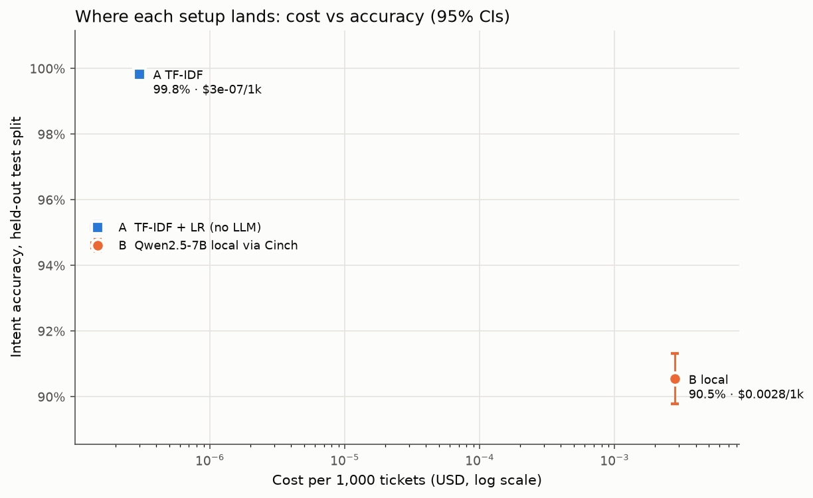
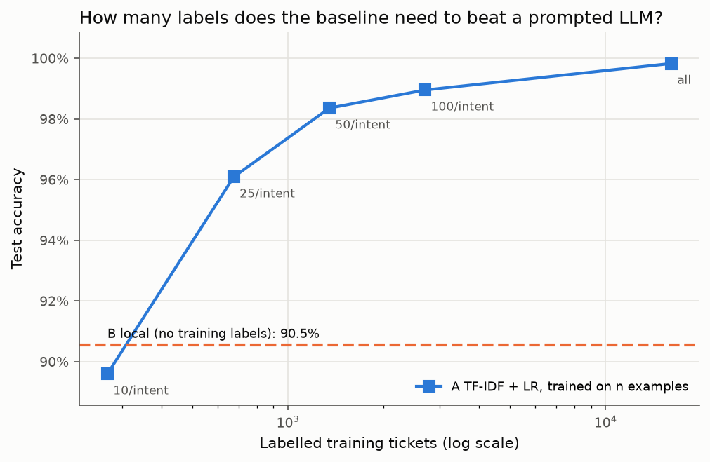

# Case study: what does a correct support-ticket triage cost?

*Generated from run `main` by `tally report`. Every number traces to `marts.fct_outcomes` or to `reports/runs/main/`.*

## The headline

Hosted setup C and the cascade D have not run yet. On the held-out test split, the local model reached **90.5%** accuracy at **$0.00309 per 1,000 correct triages**, while the no-LLM baseline reached **99.8%** at **$3e-07 per 1,000**.

## 1. The problem

Teams compare LLM options by price per token. Price per token ignores the thing a business buys: a correct answer. A model that is half the price per token but misroutes one ticket in five costs more once someone re-handles those tickets. Tally measures **cost per correct triage** on held-out data, and asks whether a confidence-based cascade (local model first, hosted model when unsure) beats either model alone.

## 2. Setup

- **Data**: Bitext customer support, 26,872 tickets, 27 intents. 60/20/20 split by near-duplicate cluster (22,037 clusters), stratified by intent. Test n = 5,373.
- **A**: TF-IDF + logistic regression, trained on 16,124 dev tickets (C = 2.0, chosen on tune).
- **B**: Qwen2.5-7B-Instruct AWQ on one RTX 3060 Ti (vLLM 0.6.3, behind Cinch), guided choice over the 27 labels, prompt `ticket_triage.fewshot_static.v3` (chosen on tune).
- **C**: `gemini-2.5-flash-lite` (gemini), strict JSON-schema enum, same prompt.
- **D**: B first; escalate to C when temperature-scaled confidence < τ or B's output is invalid.
- **Cost model**: local GPU = amortised card + measured power, divided by measured throughput at 30% utilisation; hosted = list price per token, with cached prompt tokens at the cached price; TF-IDF = CPU seconds.

## 3. Results

| Setup | Accuracy (95% CI) | Macro-F1 | Cost per 1k tickets | Cost per 1k correct | p95 latency | Escalated |
|---|---|---|---|---|---|---|
| A  TF-IDF + LR (no LLM) | 99.8% (99.7%–99.9%) | 0.998 | $3e-07 ($3e-07–$3e-07) | $3.01e-07 ($3e-07–$3.01e-07) | 0.05 ms | – |
| B  Qwen2.5-7B local via Cinch | 90.5% (89.8%–91.3%) | 0.902 | $0.0028 ($0.0028–$0.0028) | $0.00309 ($0.00306–$0.00311) | 1,810 ms | – |
| C  hosted API model | not run | | | | | |
| D  cascade B→C | not run | | | | | |

## 4. The baseline everyone skips
The TF-IDF baseline **beat the 7B model**: 99.8% (99.7%–99.9%) vs 90.5% (89.8%–91.3%), at a cost per correct triage 10276× lower. On a balanced, template-generated dataset with 16k labelled examples, a linear model over n-grams is hard to beat. That is the point of running it: an LLM is not the default answer for a closed-label task with plenty of labels.
The learning curve shows where that changes. With 10 labels per intent the baseline reaches 89.6%; with 100 per intent, 99.0%. The prompted local model needs **no** labelled training data (only 2 examples per intent in the prompt) and reaches 90.5%. When labels are scarce, or when the label set changes faster than you can relabel, the LLM earns its cost; when you have thousands of clean labels for a fixed taxonomy, it does not.

## 6. The cache finding

Cinch's semantic cache compares the **whole prompt** (system prompt plus ticket) by term-frequency cosine, at a 0.95 threshold, in one store shared by all tenants. A triage prompt is about 1,500 tokens of fixed instructions and examples plus a ticket of about 10 words, so two different tickets look almost identical to it.

With the cache on, 99.6% of test tickets were cache hits, and only 3.3% of those hits returned the right label for the ticket being asked. Accuracy fell from 90.5% to 3.7%; 4,672 tickets the model answered correctly without the cache came back wrong with it. Cost fell from $0.015 to $0.00541 for the split, which is a saving on paper and a loss in practice.

The fix is specified in `docs/CINCH_CHANGES.md` (C3): key the cache by tenant and system-prompt hash, and compare only the user message. Headline numbers in this study use the cache-off run.

## 7. ROI, and how much it depends on assumptions

Base case: 1.5 minutes saved per correct triage, $6.0/hour, 4.0 minutes lost per misroute, 100,000 tickets a month.

| Setup | Net USD / month | AI cost / month | Break-even accuracy |
|---|---|---|---|
| A  TF-IDF + LR (no LLM) | 14,908 | 0.00 | 72.7% |
| B  Qwen2.5-7B local via Cinch | 9,800 | 0.28 | 72.7% |

At these volumes the AI bill is small next to the labour terms for every setup. The decision turns on accuracy (each misroute costs 4.0 minutes of an agent) far more than on price per token. The 27-case sensitivity grid in `docs/RESULTS.md` shows the ranking under cheaper and more expensive labour.

## 8. Limitations

- Bitext is synthetic and template-generated; real tickets are longer, noisier and multi-intent. The cluster split removes near-duplicate leakage but cannot make the task realistic.
- Public data may be in either model's training set. Neither model was probed for memorisation of Bitext.
- One local GPU at 30% assumed utilisation; one hosted model at list price on 2026-11-19. Utilisation is the cost-model input that moves local cost the most.
- Prompts were tuned on the local model only; the hosted model might do better with its own prompt.
- Latency for the cascade adds the two calls; a production router could start the hosted call speculatively.

## 9. What I would do next

1. Move the calibrated cascade into Cinch (it already has a cascade stage, driven by regex today) and emit the spans there (`docs/CINCH_CHANGES.md` C1).
2. Fix the semantic cache keying (C3) and re-run the cache arm to measure the honest saving.
3. Repeat the study on real tickets with a changing taxonomy, where the learning curve says LLMs should win.
4. Feed Telltale's live signals (re-opened tickets, agent re-routes) into `fct_outcomes` as `outcome_source = 'telltale_signal'`, so cost per correct can be measured in production, not only on a labelled split.
