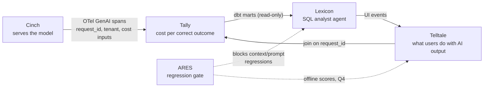

# Portfolio Plan: Tally → Lexicon → Telltale

This is the master plan across all three projects. It lives in Tally because Tally is the hub; Lexicon and Telltale link here.

## 1. How the pieces connect

The shared thread is one `request_id` per model call, created by the caller and carried through the gateway, the spans, the warehouse and the user events. Contract: `CONTRACTS.md`.

One sentence for a recruiter: *"I serve models (Cinch), measure what each correct answer costs (Tally), make that data queryable by an agent that knows what it means (Lexicon, gated by ARES), and check whether users actually accept the output (Telltale)."*

## 2. Timeline

| Portfolio week | Main work (≈70%) | Parallel (≈30%) | Milestone |
|---|---|---|---|
| 1 | Tally: data, splits, warehouse, Cinch telemetry PR | | Spans land in Postgres |
| 2 | Tally: ingest, setups A + B | | |
| 3 | Tally: setups C + D, calibration, dbt marts | | Marts with contracts |
| 4 | Tally: sealed test run, cache study, dashboard | | Hero chart |
| 5 | Tally: reproduce, case study, README | | **Tally ships** |
| 6 | Lexicon: snapshot, context YAML, golden set | Telltale: schema, SDK core, host decision | |
| 7 | Lexicon: guard, executor, graph, eval harness | Telltale: ingest, MindStack integration | |
| 8 | Lexicon: ablation, BIRD, ARES gate | Telltale: **go live**, classifier, WildChat | Data collection starts |
| 9 | Lexicon: app, README | Telltale: Lexicon UI events, freeze the analysis plan | **Lexicon ships** |
| 10–11 | Telltale: marts, WildChat analyses, data health | Portfolio site updates | |
| 12 | Telltale: analysis + report | | **Report out** (about Feb–Mar 2027) |

Week 1 starts whenever you begin. If you start on 2026-11-23, week 12 ends around 2027-02-14, plus slack for exams and holidays.

## 3. Homepage order and site changes

Order: **Tally, Lexicon, Cinch** at the top, then Telltale, ARES, Nexus, MindStack, OFFBoarder, MaSheba AI. Add the diagram above as one image near the top.

The portfolio site at `H:\Projects\my-portfolio-main-system-engineer` is vanilla JS with Vite. Adding a project takes three edits, made in that repo when each project ships:
1. Add an entry to `src/projects.js`: `{name, category, summary, tags, problem, approach, decisions[], reflection, visual, repo, next}`. Fix the `next` chain to match the new order.
2. Add the slug to the hard-coded list in `scripts/static-pages.mjs`.
3. Add a card linking to `/work/<slug>` in `index.html`.

Things to fix while you are there:
- GitHub links use `Rytnixx786` (double x) on the site, but `Rytnix786` in the Cinch and ARES READMEs. Pick one.
- The case pages say benchmark figures are omitted until they can be linked to source artefacts. Tally, Lexicon and Telltale all produce run-id-linked artefacts, so their pages can show numbers.

## 4. What "world class" means here (the bar for all three)

1. **Honest baselines and nulls.** The TF-IDF baseline, the ablation and Q4 are all reported whichever way they come out.
2. **Pre-declared decisions.** τ objective (Tally), thesis statistic (Lexicon), analysis plan (Telltale): each is written down before the data that tests it.
3. **Uncertainty everywhere.** CIs on every number; the unit of analysis stated.
4. **Reproducible by a stranger.** Replay mode, frozen snapshots, run ids in every README number.
5. **Contracts between projects.** dbt model contracts, a shared event schema, shared ids, and gates that block regressions.
6. **Safety and privacy by construction.** A read-only SQL agent with defence in depth; telemetry with no text.
7. **Prose without slop.** Numbers, assumptions next to them, limitations in plain words.
