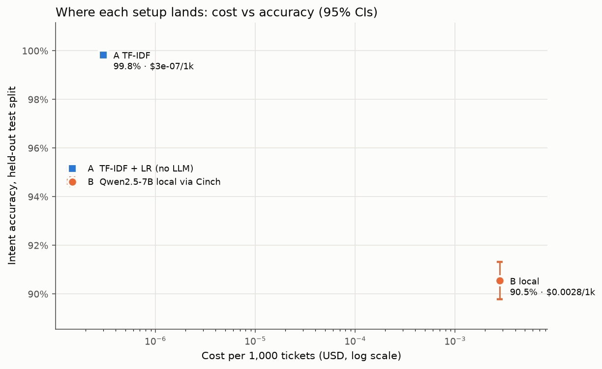
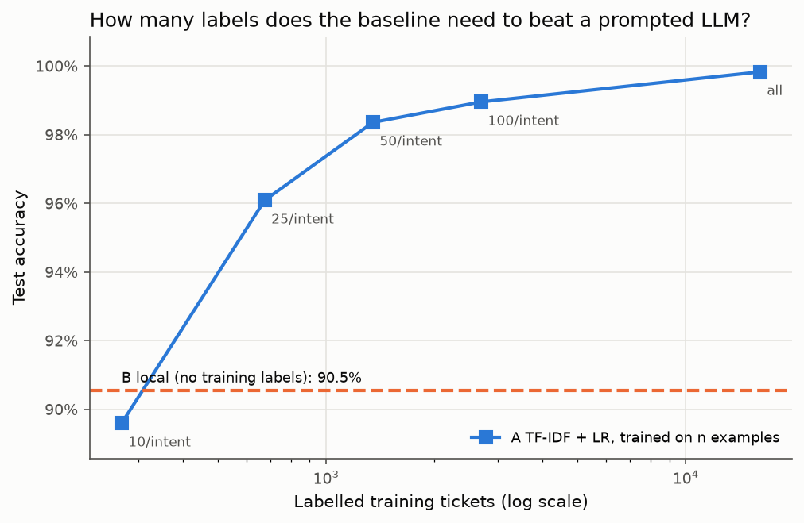
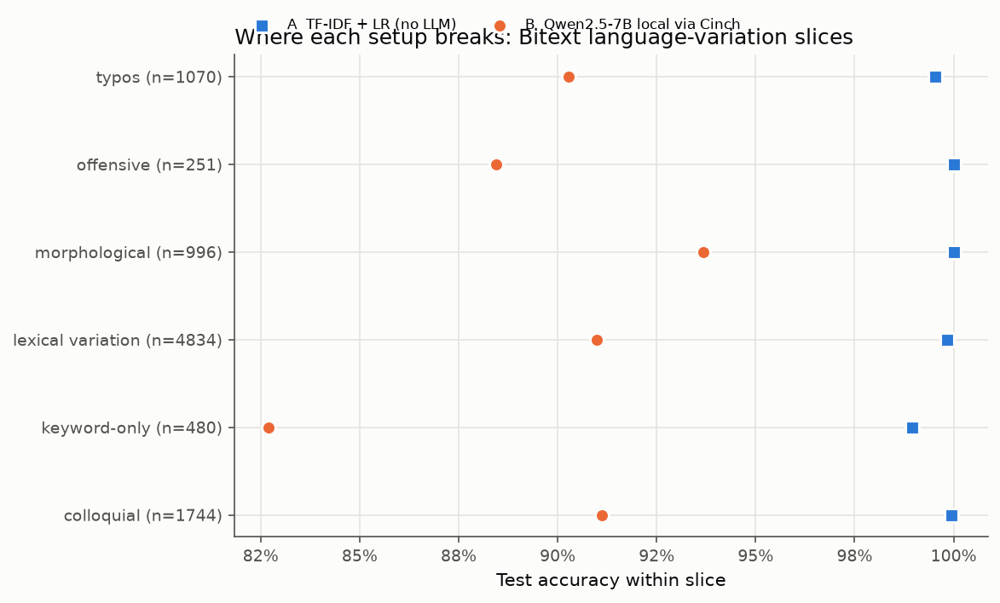
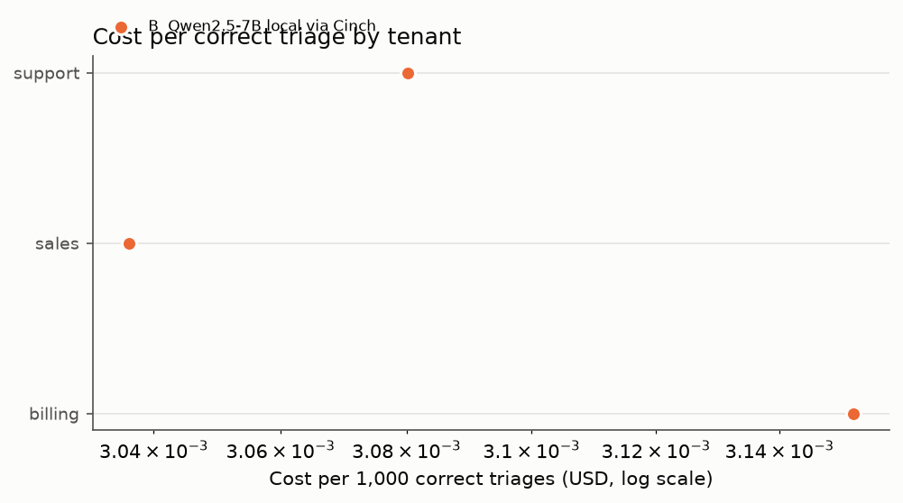

# Results (generated)

> Generated by `tally report` from run `main` (source: warehouse). Do not edit by hand.
> Held-out **test** split unless marked. 95% confidence intervals from a paired bootstrap over tickets
> (2000 resamples, seed 7).

## Headline

Hosted setup C and the cascade D have not run yet. On the held-out test split, the local model reached **90.5%** accuracy at **$0.00309 per 1,000 correct triages**, while the no-LLM baseline reached **99.8%** at **$3e-07 per 1,000**.

## Main table (test split, n = 5,373 tickets per setup)

| Setup | Accuracy (95% CI) | Macro-F1 | Cost per 1k tickets | Cost per 1k correct | p95 latency | Escalated |
|---|---|---|---|---|---|---|
| A  TF-IDF + LR (no LLM) | 99.8% (99.7%–99.9%) | 0.998 | $3e-07 ($3e-07–$3e-07) | $3.01e-07 ($3e-07–$3.01e-07) | 0.05 ms | – |
| B  Qwen2.5-7B local via Cinch | 90.5% (89.8%–91.3%) | 0.902 | $0.0028 ($0.0028–$0.0028) | $0.00309 ($0.00306–$0.00311) | 1,810 ms | – |
| C  hosted API model | not run | | | | | |
| D  cascade B→C | not run | | | | | |

Cost per 1k tickets and per 1k correct are in US dollars from Tally's cost model
(`config/cost_model.yaml`: local GPU method `owned_gpu`, utilisation 30%).

| Setup | Category accuracy | Invalid outputs | p50 latency |
|---|---|---|---|
| A  TF-IDF + LR (no LLM) | 100.0% | 0.00% | 0.05 ms |
| B  Qwen2.5-7B local via Cinch | 95.9% | 0.00% | 1,298 ms |

## Are the differences real? (exact McNemar, Holm-adjusted)

| Comparison | Only first correct | Only second correct | p (Holm) |
|---|---|---|---|
| A_tfidf vs B_local | 504 | 5 | 3.4e-142 |

Local model vs TF-IDF baseline: accuracy ratio 0.907
(0.899–0.915),
cost-per-correct ratio 1.03e+04.

## Tune split (where choices were made)

| Setup | Tune accuracy |
|---|---|
| A  TF-IDF + LR (no LLM) | 99.8% |
| B  Qwen2.5-7B local via Cinch | 91.0% |

Prompt selection (local model, tune split): `ticket_triage.fewshot_static.v3` 91.0%, `ticket_triage.zero_shot.v1` 84.7%.
Chosen: `ticket_triage.fewshot_static.v3`. TF-IDF regularisation chosen on tune: C = 2.0.

## Cost vs accuracy

## Learning curve of the baseline

| Labels per intent | Training tickets | Test accuracy |
|---|---|---|
| 10 | 270 | 89.6% |
| 25 | 675 | 96.1% |
| 50 | 1,350 | 98.4% |
| 100 | 2,700 | 99.0% |
| all | 16,124 | 99.8% |

## Slices

### By tenant

| Setup | Tenant | n | Accuracy | Cost per 1k correct |
|---|---|---|---|---|
| A  TF-IDF + LR (no LLM) | billing | 1688 | 99.9% | $3e-07 |
| A  TF-IDF + LR (no LLM) | sales | 1714 | 99.8% | $3.01e-07 |
| A  TF-IDF + LR (no LLM) | support | 1971 | 99.8% | $3.01e-07 |
| B  Qwen2.5-7B local via Cinch | billing | 1688 | 88.7% | $0.00315 |
| B  Qwen2.5-7B local via Cinch | sales | 1714 | 92.1% | $0.00304 |
| B  Qwen2.5-7B local via Cinch | support | 1971 | 90.8% | $0.00308 |

### By language variation (Bitext flags)

| Setup | Slice | n | Accuracy |
|---|---|---|---|
| A  TF-IDF + LR (no LLM) | typos | 1070 | 99.5% |
| A  TF-IDF + LR (no LLM) | colloquial | 1744 | 99.9% |
| A  TF-IDF + LR (no LLM) | offensive | 251 | 100.0% |
| A  TF-IDF + LR (no LLM) | keyword-only | 480 | 99.0% |
| A  TF-IDF + LR (no LLM) | morphological | 996 | 100.0% |
| A  TF-IDF + LR (no LLM) | lexical variation | 4834 | 99.8% |
| B  Qwen2.5-7B local via Cinch | typos | 1070 | 90.3% |
| B  Qwen2.5-7B local via Cinch | colloquial | 1744 | 91.1% |
| B  Qwen2.5-7B local via Cinch | offensive | 251 | 88.4% |
| B  Qwen2.5-7B local via Cinch | keyword-only | 480 | 82.7% |
| B  Qwen2.5-7B local via Cinch | morphological | 996 | 93.7% |
| B  Qwen2.5-7B local via Cinch | lexical variation | 4834 | 91.0% |

### Hardest intents (lowest accuracy, local model)

| Intent | Accuracy |
|---|---|
| check_invoice | 35.5% |
| delete_account | 65.8% |
| track_order | 66.8% |
| delivery_options | 73.9% |
| get_refund | 83.0% |
| edit_account | 85.5% |
| create_account | 86.9% |
| set_up_shipping_address | 88.9% |

## ROI (assumptions in `config/roi.yaml`)

Base case: 1.5 min saved per correct triage, $6.0/h,
4.0 min lost per misroute, 100,000 tickets/month.

| Setup | Net USD / month | AI cost / month | Break-even accuracy | Worst / best of 27 sensitivity cases |
|---|---|---|---|---|
| A  TF-IDF + LR (no LLM) | 14,908 | 0.00 | 72.7% | 1,608 / 124,721 |
| B  Qwen2.5-7B local via Cinch | 9,800 | 0.28 | 72.7% | -20,531 / 109,242 |

## Gateway semantic cache (Cinch, legacy keying)

| | Value |
|---|---|
| Tickets | 5,373 |
| Hit rate | 99.6% |
| Hit precision (hit returned the right label for *this* ticket) | 3.3% |
| Accuracy with cache on vs off | 3.7% vs 90.5% |
| Hits that were wrong but correct without the cache | 4,672 |
| Cost with cache on vs off | $0.00541 vs $0.015 |

